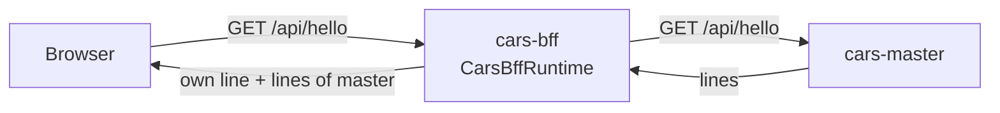

<!--
@license
Copyright (c) rljson

Use of this source code is governed by terms that can be
found in the LICENSE file in the root of this package.
-->

# The first backend for frontend: hello from two servers

## Motivation

- The browser of the cars example app talks to one backend only: this
  backend for frontend
- It gathers what the domain servers answer and hands it to the browser
- Before any real API exists, the repo has to prove that it can be built,
  tested, packed into a container and that it reaches a domain server
- So its first release answers `GET /api/hello` with its own line and the
  line of `cars-master-runtime`

## Strategy

- Set the repo up the way every rljson repo is set up: the rljson DNA
  for guides and skills, the TypeScript toolchain for build and tests
- Run as an app of its own, the container `cars-bff`
- Ask `cars-master-runtime` over HTTP, never as a linked package, so both
  are built and deployed on their own
- Keep the package private (`"private": true`), never on npm

## Implementation: the setup

- `gg dna init` and `gg dna add @rljson/dna-rljson` brought the guides,
  the skills for Claude and the GitHub checks
- vite builds the package, vitest tests it with 100 % coverage, eslint
  checks the code and its JSDoc
- `index.jsonc` names `cars-master-runtime` in `interfaces.uses`

## Implementation: the server

- `CarsBffRuntime` is a plain `node:http` server:
  - `GET /api/hello` answers `{ lines }`: `Hello from cars-bff-runtime`,
    then the lines of each hello source
  - `GET /health` answers `ok`
  - every other request answers 404
- A hello source is an async function that returns lines
- `masterSource(url)` fetches `GET <url>/api/hello` from
  `cars-master-runtime`; without an answer it returns
  `No answer from cars-master-runtime`, so the page never breaks
- `start()` reads `PORT` (default 3000) and `MASTER_URL` (default
  `http://cars-master:3000`)
- The tests run a small master stub on a free port

## Implementation: the container

- A multi-stage Dockerfile on `node:22-alpine` builds the package and
  keeps only the production dependencies
- The container runs as uid 1000, sets `MASTER_URL` and calls `start()`
- `az acr build` builds it in the registry, tag `<version>-<sha>`

## Result

- The container `cars-bff` answers two lines: its own and the one of
  `cars-master`

## Open Points

- No sign-in yet
- The real API of the cars data replaces the hello world later
