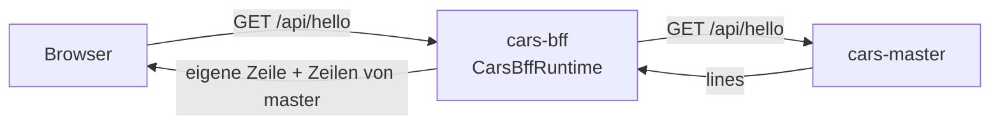

<!--
@license
Copyright (c) rljson

Use of this source code is governed by terms that can be
found in the LICENSE file in the root of this package.
-->

# Das erste Backend for Frontend: Hello von zwei Servern

## Motivation

- Der Browser der cars-Beispiel-App spricht nur mit einem Backend: diesem
  Backend for Frontend
- Es sammelt, was die Server der Domänen antworten, und reicht es an den
  Browser weiter
- Bevor es eine echte API gibt, muss das Repo zeigen, dass es sich bauen,
  testen und in einen Container packen lässt und einen Domänen-Server
  erreicht
- Sein erstes Release beantwortet deshalb `GET /api/hello` mit seiner
  eigenen Zeile und der von `cars-master-runtime`

## Strategie

- Das Repo so aufsetzen wie jedes rljson-Repo: die rljson-DNA für
  Anleitungen und Skills, die TypeScript-Toolchain für Build und Tests
- Als eigene App laufen, der Container `cars-bff`
- `cars-master-runtime` über HTTP fragen, nie als eingebundenes Paket,
  damit beide für sich gebaut und deployt werden
- Das Paket privat halten (`"private": true`), nie auf npm

## Umsetzung: der Aufbau

- `gg dna init` und `gg dna add @rljson/dna-rljson` brachten die
  Anleitungen, die Skills für Claude und die GitHub-Prüfungen
- vite baut das Paket, vitest testet es mit 100 % Abdeckung, eslint
  prüft den Code und sein JSDoc
- `index.jsonc` nennt `cars-master-runtime` in `interfaces.uses`

## Umsetzung: der Server

- `CarsBffRuntime` ist ein einfacher `node:http`-Server:
  - `GET /api/hello` antwortet `{ lines }`: `Hello from cars-bff-runtime`,
    dann die Zeilen jeder Hello-Quelle
  - `GET /health` antwortet `ok`
  - jede andere Anfrage antwortet 404
- Eine Hello-Quelle ist eine asynchrone Funktion, die Zeilen liefert
- `masterSource(url)` holt `GET <url>/api/hello` von
  `cars-master-runtime`; ohne Antwort liefert sie
  `No answer from cars-master-runtime`, damit die Seite nie bricht
- `start()` liest `PORT` (Standard 3000) und `MASTER_URL` (Standard
  `http://cars-master:3000`)
- Die Tests starten einen kleinen Master-Stub auf einem freien Port

## Umsetzung: der Container

- Ein mehrstufiges Dockerfile auf `node:22-alpine` baut das Paket und
  behält nur die Produktionsabhängigkeiten
- Der Container läuft als uid 1000, setzt `MASTER_URL` und ruft `start()`
  auf
- `az acr build` baut ihn in der Registry, Tag `<version>-<sha>`

## Ergebnis

- Der Container `cars-bff` antwortet zwei Zeilen: seine eigene und die von
  `cars-master`

## Offene Punkte

- Noch keine Anmeldung
- Die echte API der cars-Daten ersetzt später das Hello World
